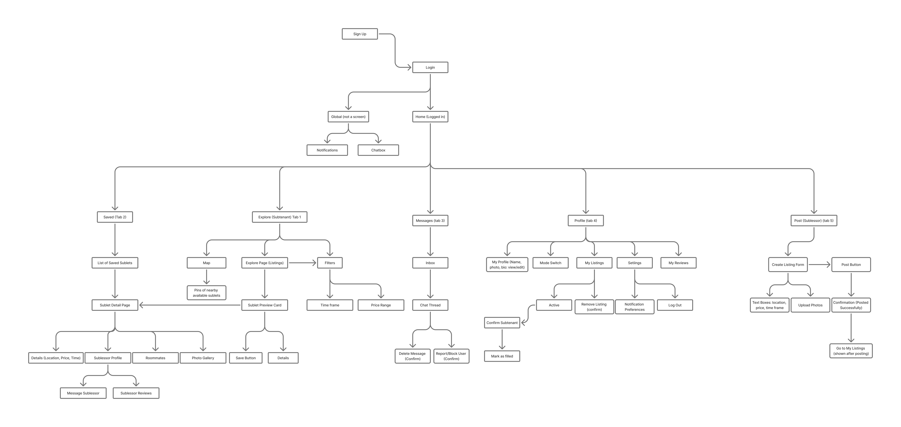

- [app map & wireframe instructions](instructions-0a-app-map-wireframes.md).
- [prototype instructions](instructions-0b-prototyping.md)

# UX Design Documentation

This document outlines the user experience architecture and wireframes for the application.

---

## App Map

The app map below provides a high-level visual overview of the application's structure, navigation paths, and user flow.
* **Figma Board:** [Sublet Search App Map](https://www.figma.com/board/jDfLwlhhxFzzD40WKhqoXR/Sublet-Search?node-id=0-1&t=KunZ1wOHs1ZpcKfY-1)

  

---

## Wireframes

### 1. Explore – Listings
Users can search for sublets, filter by price and availability, save listings, and view apartment details.

### 2. Explore – Map View
Displays available sublets on a map with location pins and listing previews.

### 3. Sublet Details
Shows apartment photos, rent, dates, description, roommate information, reviews, and contact options.

### 4. Saved Sublets
Users can review saved listings, open details, or remove saved properties.

### 5. Messages – Inbox
Shows the user's conversations with sublessors and links to individual chats.

### 6. Messages – Conversation
Displays the message thread, reply box, and report or block options.

### 7. Profile
Displays personal information, account mode, user reviews, listing management, and account settings.

### 8. Post a Sublet
Allows sublessors to enter listing details, rent, availability, description, and upload photos.

### 9. Listing Posted Confirmation
Confirms that the listing has been posted and provides a link to My Listings.

### 10. Login
Allows existing users to sign in with their email and password.

### 11. Sign Up
Allows new users to create an account with their name, email, and password.

## Prototype

The prototype below provides basic flows for the login and register auth flows, and basic usage of the sublet apps for both desktop and mobile. It includes basic implementation of the main page, posting a listing, a profile page, and message features.

https://www.figma.com/design/YxLAE4LDtG6rfZcYQcRrMQ/Sublet-Search-%E2%80%93-Wireframes?node-id=0-1&t=uzraE1vmSBLad6cO-1
